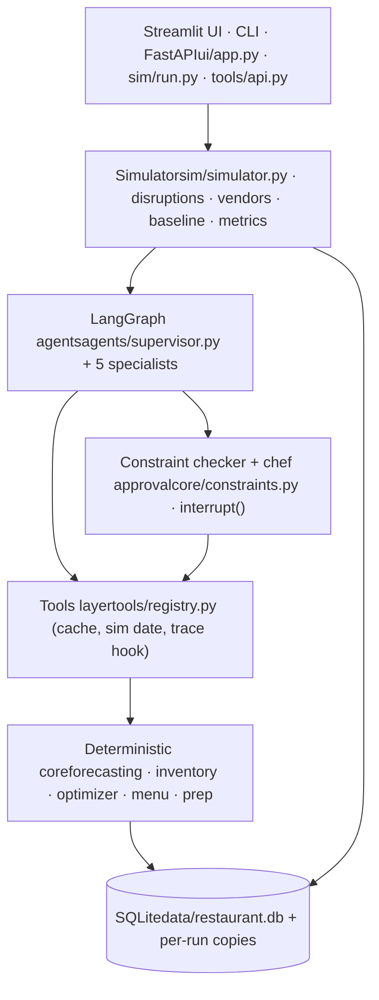
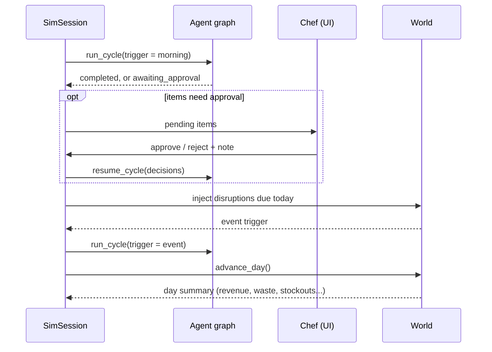
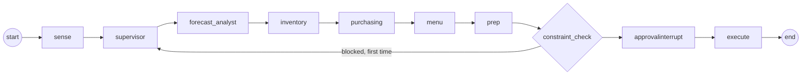

Contents

1. [The short version](#overview)
2. [Four layers](#layers)
3. [File map](#files)
4. [World and data](#data)
5. [One simulated day](#day)
6. [The agent graph](#graph)
7. [The five agents](#agents)
8. [Tools layer](#tools)
9. [Deterministic core](#core)
10. [Constraints and approval](#constraints)
11. [Simulator and baseline](#sim)
12. [KPIs](#kpis)
13. [Streamlit UI](#ui)
14. [LLM configuration](#llm)
15. [Database tables](#tables)
16. [First live run](#watch)

# Restaurant Ops Agents

A walkthrough of the whole codebase in `ResturantAgent/`: what each part does, what goes in and comes out, and how one simulated day flows through the system.

LLM **meta:muse-spark-1.3** mode **live** Python **3.12** \~7,500 lines sim week **Mon 2 Nov – Sun 8 Nov 2026**

## The short version

The project simulates one 80-seat bistro for a week. Each morning, and again whenever something goes wrong, a team of five AI agents plans the day. They forecast demand, check stock, order from suppliers, change the menu and write prep lists. A fixed-rule baseline runs the same week on an identical copy of the world, so you can compare waste, stockouts and food cost.

**The one rule that shapes everything:** numbers come from models and code; judgment comes from agents. An agent never calculates a quantity or price. It calls a tool, reads the number, and *proposes* an action. Every proposal then passes a deterministic constraint checker before anything changes, and the LLM cannot override a block.

Your sidebar shows `meta:muse-spark-1.3` in live mode. That means every specialist agent and the supervisor's event planning call Meta's API. Without a key the same graph runs with rule-based "mock" agents instead.

## Four layers

Each layer only talks to the one below it. The agents never touch the database directly.



| Layer | Responsible for | Never does |
| --- | --- | --- |
| Forecasting model | Covers and dish mix per meal period, with P10 / P50 / P90 bands | Business decisions |
| Optimizer | Order quantities and supplier split | Interpret unusual situations |
| Constraint checker | Shelf life, FEFO, min order, budget, capacity, allergens, lead time | Get overridden by an LLM |
| LLM agents | Spot anomalies, compare options, negotiate, explain | Arithmetic or stock counts |

## File map

Every Python file, grouped by package, with what it takes in and gives back.

| File | Role | In → Out |
| --- | --- | --- |
| `config.py` | All settings, read from `.env` | env vars → `settings` singleton |
| `db/schema.sql` | Every table | — |
| `db/connection.py` | SQLite helpers, DB copy | path → connection, DataFrame |
| `data/catalog.py` | Static world: 60 ingredients, 20 dishes with recipes, 4 suppliers, stations | — → Python data + `load_catalog(conn)` |
| `data/generator.py` | Hidden "true" demand + 365 days of history | date, events, weather → covers and dish sales |
| `data/seed.py` | Builds the database | CLI → `data/restaurant.db` |
| `core/forecasting.py` | LightGBM quantile models, signal report | dates → P10/P50/P90 covers and dishes |
| `core/inventory.py` | Lots, FEFO, usage, waste risk, variance | date → stock and risk lists |
| `core/optimizer.py` | MILP order planner + greedy fallback | date, horizon, budget → orders per supplier |
| `core/constraints.py` | Validates every action | action → list of violations |
| `core/menu.py` | Recipes, margins, allergens, feasible portions | dish → numbers |
| `core/prep.py` | Prep quantities and station load | date, period → per-station list |
| `tools/registry.py` | Wraps core as tools; per-agent toolsets | tool call → JSON dict |
| `tools/api.py` | FastAPI over the same functions | HTTP → JSON |
| `agents/llm.py` | Builds the chat model per provider | settings → LangChain model |
| `agents/state.py` | `Action`, `AgentReport`, graph state | — |
| `agents/prompts.py` | System prompt per agent | context → prompt text |
| `agents/base.py` | Runs one specialist (live or mock), never raises | state → `AgentReport` |
| `agents/forecast_analyst.py` + 4 more | One graph node per specialist | state → report + proposals |
| `agents/mock_policies.py` | Rule-based stand-ins for offline runs | context → `AgentReport` |
| `agents/supervisor.py` | The graph and its public API | run id, date, trigger → final state or pause |
| `agents/decision_log.py` | Writes `decisions` and `trace` | events → DB rows |
| `sim/simulator.py` | `World`: runs one day of service | DB copy → day summary |
| `sim/disruptions.py` | The four scenarios | scenario name → world changes + trigger |
| `sim/vendors.py` | Mock supplier negotiation | offer → counter-offer |
| `sim/baseline.py` | Fixed-par ordering policy | world → POs |
| `sim/metrics.py` | KPIs and comparison | run DBs → numbers |
| `sim/run.py` | `SimSession`, `run_simulation`, CLI | policy, scenario, days → results |
| `ui/app.py`, `ui/components.py` | Streamlit app | clicks → `SimSession` calls |
| `tests/test_constraints.py` | \~40 constraint tests | — |

## World and data

### What `seed` builds

`uv run python -m restaurant_ops.data.seed` creates `data/restaurant.db`. It loads the catalog, then generates a year of history ending Sunday 1 Nov 2026, using a fixed seed (42), so every run produces the same world.

Menu

20 dishes across starters, mains, sides and desserts. Each has a price, station, prep minutes and a recipe (quantity of each ingredient per portion).

Ingredients

60 items, each with unit, storage, shelf life, allergens, reference cost and season.

Suppliers

4 suppliers with overlapping items, different prices, lead times, minimum orders and reliability.

History

365 days of covers, dish sales, weather, events, reservations, staffing and stock counts. Opening lots, some close to expiry.

| Supplier | Lead time | Min order | Fill rate | Delay chance |
| --- | --- | --- | --- | --- |
| `sup_freshcatch` FreshCatch Seafood | 1 day | $120 | 92% | 8% |
| `sup_metro` Metro Wholesale | 2 days | $250 | 97% | 5% |
| `sup_greenvalley` Green Valley Farms | 1 day | $100 | 90% | 12% |
| `sup_budget` Budget Foods Co. | 3 days | $400 | 85% | 20% |

### The hidden demand model

`generator.py` holds the "truth" the agents never see directly. The forecaster has to learn these effects from history. The simulator uses the same functions to produce each future day's real demand.

- **Base covers** (a mid-year Thursday): lunch 52, dinner 92, late 22.
- **Day of week:** Friday and Saturday dinner ×1.35–1.45, Monday dinner ×0.70.
- **Payday** (15th and last day of the month): ×1.09. The start of the month has *no* effect, so the signal report can show that it doesn't matter.
- **Season:** summer patio peak, December party bump. Seasonal dishes only sell in season.
- **Holidays** and **local events** have their own per-period multipliers.
- **Home game:** dinner and late ×1.25, with fried food ×1.6.
- **Heat** above 30 °C: cold dishes +40%, hot mains −20%. This changes the dish mix, not covers.
- **Capacity:** 80 seats × turns caps covers at 120 lunch, 160 dinner, 48 late.
- **Noise:** negative-binomial, seeded per date, so a given date always plays out the same way.

Two planted problems give the agents something to find: cod, cream, mozzarella, spinach and mushroom lots start near expiry, and ribeye shows about 6.5% shrinkage in stock counts.

## One simulated day

`SimSession.step_day()` in `sim/run.py` drives everything. The UI's "Step day" button and the CLI both call it.



1. **Morning cycle.** The agent policy runs the full graph with all five specialists. The baseline policy just runs `BaselinePolicy.plan()`.
2. **Chef pause.** If any action needs approval, the graph stops and `step_day` returns `awaiting_approval`. The UI shows the items, and `resume()` continues.
3. **Disruptions.** Any scenario events dated today are applied to the world after the morning plan, so the morning plan didn't know about them.
4. **Event cycle.** For each disruption the agent policy runs the graph again, re-running only the affected specialists. The baseline doesn't react.
5. **Service.** `World.advance_day()` runs the day: deliveries, demand, menu effects, cooking, expiry and KPIs. Then the date moves to tomorrow.

Each policy has its own database copy at `data/runs/{run_id}_{policy}.db`. Demand and delivery luck are seeded by date and supplier, so the agent and the baseline face exactly the same week.

## The agent graph

`agents/supervisor.py` builds a LangGraph `StateGraph`. One cycle runs from `sense` to `execute`.



The chain only shows the morning order. The supervisor picks a subset, and each specialist routes to the next one in its plan or to `constraint_check`.

| Node | What it does |
| --- | --- |
| `sense` | Points the tools at this run's DB and date. Pulls 3 days of reservations, events, weather and a stock summary. Resets reports and proposals from any earlier cycle. |
| `supervisor` | Morning: all five agents in order. Event: in live mode the LLM picks the smallest set to re-run (structured `Plan` output). In mock mode, or if the LLM fails, it uses a fixed rule table. On a retry it re-runs only the agents whose actions were blocked. |
| specialists | Each one runs a ReAct agent with its own tools and returns an `AgentReport`: summary, findings and proposed actions. Upstream reports are passed to downstream agents in their prompt. |
| `constraint_check` | Runs `check_action` on every proposal. If something is blocked and no retry has happened yet, it sends the violation messages back through the supervisor once. Otherwise it writes every proposal to `decisions` as blocked, pending approval, or proposed. |
| `approval` | If anything needs the chef, it calls LangGraph's `interrupt()`. The graph state is saved to `data/checkpoints.db` and the cycle pauses until `resume_cycle` sends decisions. |
| `execute` | Re-checks each approved or approval-free action (the world may have changed), then applies it: sends POs, updates the menu, discards lots. Prep lists and flags are recorded only. |

**Event re-run rules** (fallback when the LLM isn't planning):

| Event | Agents re-run |
| --- | --- |
| `supplier_shortfall` | purchasing, menu, prep |
| `private_booking` | forecast, inventory, purchasing, prep |
| `cooler_failure` | inventory, purchasing, menu, prep |
| `heatwave` | forecast, menu, prep |

**Public API** used by the simulator, UI and FastAPI:

```
run_cycle(run_id, sim_date, trigger, db_path=None, auto_approve=False) -> dict
    # {"status": "completed", ...final state}  or
    # {"status": "awaiting_approval", "pending": [...], "thread_id": ...}
resume_cycle(thread_id, decisions=[{"id", "approved", "note"}]) -> dict
get_pending(thread_id) -> list[dict]

trigger = {"kind": "morning"}
trigger = {"kind": "event", "event": {"kind": "supplier_shortfall", "params": {...}}}
thread_id = "{run_id}:{sim_date}:{morning | event kind}"
```

### What the agents exchange

```
class Action(BaseModel):
    action_type: "adjust_forecast" | "place_po" | "reschedule_po" | "substitute_supplier"
               | "add_special" | "86_dish" | "substitute_ingredient" | "prep_list"
               | "discard_lot" | "flag_variance"
    payload: dict       # shape per action type, documented in core/constraints.py
    rationale: str      # must cite the tool output it is based on
    agent: str
    est_cost: float

class AgentReport(BaseModel):
    agent: str
    summary: str
    findings: list[str]
    actions: list[Action]
```

State stores these as plain dicts so the SQLite checkpointer can save them. When an agent runs a second time, its new proposals replace its old ones instead of piling up.

## The five agents

| Agent | Decides | Tools | Can propose |
| --- | --- | --- | --- |
| Forecast Analyst | Whether to trust the forecast; adjusts it for things the model can't see, like a new private booking | `forecast_covers`, `forecast_dish_mix`, `event_calendar`, `signal_report`, `weather`, `reservations_summary` | `adjust_forecast` (factor 0.5–1.6) |
| Inventory | Lots at risk of expiring; shrinkage; what to throw away | `stock_by_lot`, `expected_usage`, `variance_report`, `waste_risk` | `flag_variance`, `discard_lot` |
| Purchasing | What to order and from whom; what to do when a supplier fails | `optimize_orders`, `supplier_quotes`, `negotiate` | `place_po`, `reschedule_po`, `substitute_supplier` |
| Menu | Specials that use at-risk stock; dishes to 86; substitutions | `recipes`, `margin_calc`, `allergen_check`, `dishes_using`, `feasible_portions`, `waste_risk` | `add_special`, `86_dish`, `substitute_ingredient` |
| Prep Planner | Prep list per station for each meal period | `prep_quantities`, `station_capacity` | `prep_list` |

A few behaviours worth knowing:

- **Forecast adjustments apply immediately.** The Forecast Analyst's valid `adjust_forecast` actions are logged as executed at once and the tool cache is cleared. Every downstream agent then sees the adjusted numbers. They never need chef approval.
- **Prompts** (`agents/prompts.py`) tell each agent its role, its tools, the exact payload shapes, the "numbers only from tools" rule, upstream reports, recent chef decisions, and any constraint feedback from a blocked attempt.
- **Step cap:** each agent gets at most 8 tool-loop iterations (`MAX_AGENT_STEPS`).
- **Errors don't stop the cycle.** If the model or a tool fails, the agent returns a report with the error in `findings` and no actions.
- **Mock policies** (`mock_policies.py`) do the same jobs with plain rules. For example, the mock purchasing agent handles a shortfall by quoting other suppliers for the missing quantity, negotiating lines over $300, and proposing `substitute_supplier`.

## Tools layer

`tools/registry.py` is the only way agents reach numbers. Each core function is wrapped twice: once as a plain function (used by mock policies and the graph) and once as a LangChain `@tool` (given to live agents).

- **Simulated date.** `set_sim_date()` stores today's date in a context variable. Tools read it themselves, so an agent can't pass the wrong date.
- **Database.** `set_db_path()` points tools at the current run's copy.
- **Cache.** Results are cached by tool name, arguments, date and database. `clear_cache()` runs whenever the world changes.
- **Trace hook.** Every call is reported to `decision_log`, which writes `tool_call` / `tool_result` rows to the `trace` table. That's what the UI's Agent trace tab shows.
- **Write tools are hidden.** `send_po` changes the world, so it is in no agent's toolset. Only the `execute` node calls it.

`tools/api.py` exposes the same functions over HTTP (`uv run uvicorn restaurant_ops.tools.api:app`), plus `/decisions`, `/trace`, `/kpis` and `/cycle/run`, `/cycle/resume`, `/cycle/pending`.

## Deterministic core

No LLM imports anywhere in `core/`. Every function takes plain arguments and returns JSON-ready dicts.

### Forecasting — `core/forecasting.py`

- **Features (17):** meal period, day of week, day of month, payday, start of month, week of year, season, month, holiday, sports, local and private events, temperature, heat flag, booked covers, seat cap.
- **Covers:** three LightGBM quantile models (α = 0.1, 0.5, 0.9) give P10, P50 and P90, clamped to seat capacity and kept in order.
- **Dish mix:** a second model predicts each dish's share of portions; dish quantity = share × covers × portions per cover.
- **Training:** models are trained the first time they're needed and pickled to `data/models/forecast_models.pkl`. Accuracy and the signal report use a model trained on the first 335 days and tested on the last 30. The saved production model is refit on all 365.
- **Signal report:** removes or shuffles each signal on the test month and measures how much the forecast gets worse. A signal counts as significant at a 3% or larger effect. This is where "payday matters, start of month doesn't" comes from.
- **Adjustments:** executed `adjust_forecast` decisions multiply the forecast for that date and period.
- **Fallback:** if LightGBM can't be imported, a day-of-week × period average with the same interface is used.

### Inventory — `core/inventory.py`

- `stock_by_lot`: active lots with quantity, expiry and days left.
- `expected_usage`: forecast dish mix × recipes = ingredient need per day.
- `waste_risk`: simulates first-expired-first-out use against the forecast and lists lots that will expire before they're used, with value at risk.
- `variance_report`: compares counted vs system stock and flags persistent shrinkage or over-portioning.
- `consume_fefo`: used by the simulator to take stock from the oldest lots first, returning the cost.

### Order optimizer — `core/optimizer.py`

A PuLP mixed-integer program solved by CBC with a 10-second limit.

- **Need** = forecast usage at P90 over the window, minus usable on-hand stock, minus orders already on the way.
- **Variables:** whole packs per supplier × ingredient × delivery day, plus a yes/no per supplier-day so the minimum order value applies only when that supplier is used.
- **Constraints:** lead time, shelf life (no buying more than can be used before it spoils), budget (default $8,000 per run), excluded suppliers.
- **Cost to minimise:** spend + a shortage penalty of 6 × ingredient cost per missing unit + a reliability penalty for suppliers that short-ship or deliver late + a small charge per PO.
- **Fallback:** a greedy reorder heuristic returns the same shape if the solver fails.

### Menu and prep — `core/menu.py`, `core/prep.py`

- `margin_calc`: dish price vs recipe cost.
- `allergen_check`: allergens of a dish, with or without a substitution.
- `feasible_portions`: how many portions current stock supports.
- `prep_quantities`: forecast portions × prep minutes per station, minus dishes that are 86'd.
- `station_capacity`: staff on shift × minutes in the period × 0.8, compared with that load.

## Constraints and approval

`check_action(action, conn, as_of)` returns a list of violations, each `block` or `warn`. Any `block` stops the action.

| Blocking rule | Example of what it stops |
| --- | --- |
| `positive_quantities` | An order line with qty 0 or less |
| `supplier_carries_item` | Ordering salmon from a farm supplier |
| `lead_time` | Delivery tomorrow from a 3-day supplier |
| `min_order_value` | A $60 order to a supplier with a $250 minimum |
| `budget_daily` / `budget_weekly` | Today's POs over $8,000, or 7 days over $28,000 |
| `shelf_life` | Buying more fish than can be sold before it spoils |
| `fefo` | A special that uses a newer lot while an older one sits unused |
| `stock_available` | A special for 30 portions when stock supports 12 |
| `allergen_undeclared` | A substitution that adds nuts without declaring them |
| `station_capacity` | A prep list that overloads the grill |

Warnings (pack size, price above list, low margin and similar) are shown to the chef but don't block.

**What needs the chef** (`needs_approval`):

- Every `add_special`, `86_dish` and `substitute_ingredient`.
- Any `place_po` or `substitute_supplier` over `APPROVAL_PO_THRESHOLD` ($1,500).

Approvals and rejections are stored with the chef's note. `recent_feedback()` puts the last few into every agent's prompt, so a rejected idea isn't proposed again unless things change.

## Simulator and baseline

### `World.advance_day()`, in order

1. **Deliveries.** POs due today arrive. One random draw per date and supplier decides a one-day delay; one per ingredient decides how much is filled. An active shortfall overrides the fill rate. Delivered goods become new lots with expiry = today + shelf life.
2. **Demand.** `generator.realise_day()` produces true covers and dish orders for today, including events, weather and private bookings.
3. **Forecast log.** Today's P10/P50/P90 is saved next to actual covers for the accuracy KPIs.
4. **Menu effects.** An 86'd dish loses its orders, and 40% of them move to other dishes in the same category. A special sells 20% more, taken from other dishes, capped at its approved portions.
5. **Service.** Dishes are cooked round-robin so no one dish uses up a shared ingredient. A dish that can't be made counts as a stockout and lost revenue. Stock is consumed oldest lot first.
6. **Overnight.** Expired lots go to `waste_log`. A stock count is recorded, keeping the ribeye shrinkage. KPIs are written to `kpi_daily`.

### Disruption timeline

Disruptions land after that day's morning plan. Scenario `all` runs all four; `none` runs none.

Mon 2 Nov

Tue 3 Nov

Wed 4 Nov

Home game, dinnerCooler fails: all dairy discardedHeatwave notice

Thu 5 Nov

34 °CSalmon supplier: Friday delivery only 30% filled40-cover private dinner booked for Sat

Fri 6 Nov

34 °CShort salmon delivery arrives

Sat 7 Nov

34 °CHome game, dinnerPrivate dinner, +40 covers

Sun 8 Nov

### Mock vendors — `sim/vendors.py`

`negotiate(supplier_id, ingredient_id, qty, target_price)` returns a counter-offer. Each supplier has a persona: FreshCatch gives up to 6% off, Metro 8%, Green Valley 5%, Budget 3%. The full discount unlocks above an order-value threshold. During a shortfall, the quantity available is capped. Results are seeded, so the same request always gets the same answer.

### Baseline — `sim/baseline.py`

The comparison policy, with no agents:

- Par level = average daily use over the last 28 days × (lead time + 2).
- Each morning, if stock plus inbound is below usage × (lead time + 1), it orders up to par.
- It buys from the cheapest supplier that can deliver fresh (lead time no more than half the shelf life). That keeps its salmon on FreshCatch, so the shortfall hits it too.
- No specials, no 86's, no re-planning. Disruptions only reach it through the world.

## KPIs

`sim/metrics.py` reads each run's database. `compare()` puts agent and baseline side by side with the difference.

| KPI | Meaning | Better |
| --- | --- | --- |
| `waste_value`, `waste_pct` | Value thrown away (expired, discarded, spoiled), and as % of goods received | lower |
| `stockouts` | Times a dish ran out in a meal period | lower |
| `dishes_86d` | Dish-days taken off the menu | lower |
| `food_cost_pct` | Cost of ingredients used ÷ revenue | lower |
| `revenue`, `covers_served` | Sales and guests actually served | higher |
| `lost_revenue` | Sales lost to stockouts and 86's | lower |
| `mape`, `p90_coverage` | Forecast error vs actual covers; share of days actual stayed under P90 | lower / near 0.9 |
| `approvals_needed` | Decisions that went to the chef (agent only) | lower |

## Streamlit UI

`uv run streamlit run ui/app.py`. The sidebar sets policy (agent, baseline or both), scenario, days, seed, run id and auto-approve, and shows the LLM mode. Buttons: Start, Step day, Run to end, Reset.

| Tab | Shows |
| --- | --- |
| Run | Current date, day summaries, disruptions that fired, purchase orders, today's specials and 86's |
| Agent trace | Every supervisor decision, agent start/end, tool call and result, grouped by day and cycle, with filters and the decisions table |
| Approvals | One card per pending item with approve/reject and a note; past chef decisions below |
| Forecast | P10/P50/P90 bands for the next 3 days, forecast vs actual, the signal report, and accuracy |
| KPIs | Agent vs baseline metric cards and daily charts |

- **"Both" mode:** the agent steps first; once its day completes, the baseline steps through the same day.
- **Approvals:** when the agent pauses, stepping is disabled and the baseline waits. The Approvals tab label shows a count. Submitting resumes the graph and finishes the day.
- **Threading:** all simulation calls run on one dedicated worker thread, because SQLite connections and the checkpointer must stay on the thread that created them.
- **Browser reload** loses the in-memory sessions; the run databases stay on disk.

## LLM configuration

`agents/llm.py` builds one shared chat model from `.env`. Your current setup:

```
LLM_MODE=live
LLM_PROVIDER=meta
LLM_MODEL=muse-spark-1.3         # overrides META_MODEL (same value here)
META_BASE_URL=https://api.meta.ai/v1
META_API_KEY=...                 # or LLAMA_API_KEY
```

| Provider | How it connects |
| --- | --- |
| `meta` (default) | OpenAI-compatible client pointed at `META_BASE_URL` |
| `openai` | OpenAI client; `temperature` left out for o-series and gpt-5 models |
| `anthropic` | LangChain `init_chat_model` |
| `ollama` | Local model, no key |

For Meta and OpenAI, structured output (the `AgentReport` and the supervisor's `Plan`) is requested through tool calling instead of strict JSON schema, because `Action.payload` is a free-form dict that strict mode rejects. `LLM_MODE` left empty means live when the chosen provider has a key, mock otherwise.

## Database tables

| Group | Tables |
| --- | --- |
| Catalog | `ingredients`, `dishes`, `recipe_lines`, `suppliers`, `supplier_items` |
| Stock | `lots`, `stock_counts`, `waste_log` |
| Demand history | `covers`, `pos_sales`, `reservations`, `events`, `weather`, `staff_shifts` |
| Purchasing | `purchase_orders`, `po_lines`, `supply_overrides` |
| Menu | `menu_state` (specials and 86's per date) |
| Agent record | `decisions` (every proposal, status, violations, chef note), `trace` (timeline) |
| Results | `kpi_daily`, `forecast_log` |

Files on disk: `data/restaurant.db` (seeded world), `data/runs/*.db` (one per run and policy), `data/checkpoints.db` (paused graphs), `data/models/` (forecast models).

## First live run

**None of this has been executed yet.** Every file passes a syntax check, but no test, seed, simulation or agent call has run. Expect some runtime bugs on the first pass.

- **Order to try things:** seed → `uv run pytest` → a 1-day CLI run → the full week → the UI.
- **Cost and time in live mode:** a 7-day run of scenario `all` is 7 morning cycles × 5 agents plus 4 event cycles: roughly 50 agent runs, each with up to 8 tool steps. Try `--days 1` first.
- **Quiet failures:** if the Meta endpoint rejects tool calling or structured output, agents don't crash. They return empty reports with `error: ...` in findings. Check the Agent trace tab for `agent_end` rows with zero actions.
- **Comparing like with like:** switch `LLM_MODE=mock` to see the full loop work with no API calls, then go live.
- **First run is slow:** the forecast models train on the first call.

```
uv run python -m restaurant_ops.data.seed
uv run pytest
uv run python -m restaurant_ops.sim.run --days 1 --policy agent --scenario none --auto-approve
uv run python -m restaurant_ops.sim.run --days 7 --policy both --scenario salmon_shortfall --auto-approve
uv run streamlit run ui/app.py
```