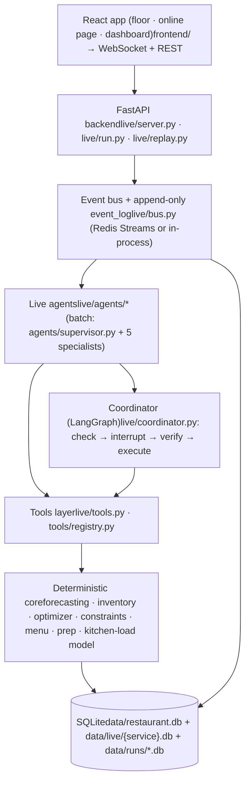
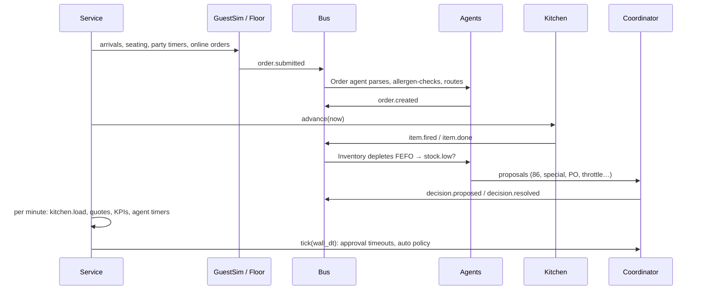
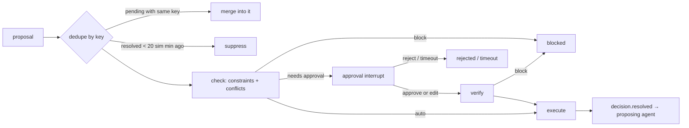
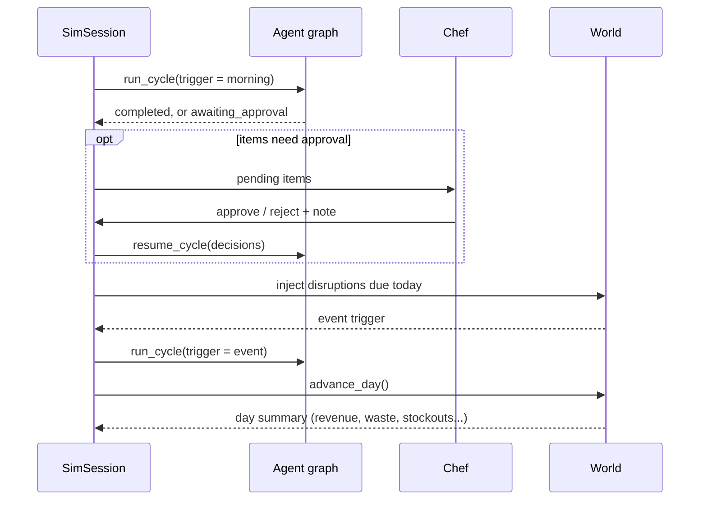
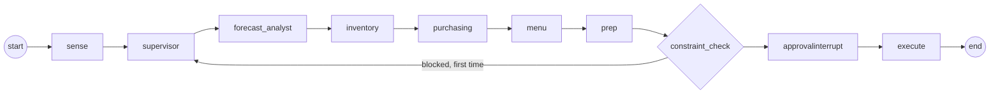

Contents

1. [The short version](#the-short-version)
2. [Two ways to run the world](#two-ways-to-run-the-world)
3. [Layers](#layers)
4. [File map](#file-map)
5. [World and data](#world-and-data)
6. [The live service](#the-live-service)
7. [Event bus and event log](#event-bus-and-event-log)
8. [The five live agents](#the-five-live-agents)
9. [The coordinator](#the-coordinator)
10. [Kitchen-load model and online quotes](#kitchen-load-model-and-online-quotes)
11. [Floor, guests, stock, menu and intraday forecast](#floor-guests-stock-menu-and-intraday-forecast)
12. [Live disruptions](#live-disruptions)
13. [Live KPIs](#live-kpis)
14. [Backend API and React app](#backend-api-and-react-app)
15. [Replay](#replay)
16. [Batch week: one simulated day](#batch-week-one-simulated-day)
17. [Batch week: the agent graph](#batch-week-the-agent-graph)
18. [Batch week: the five planning agents](#batch-week-the-five-planning-agents)
19. [Tools layer](#tools-layer)
20. [Deterministic core](#deterministic-core)
21. [Constraints and approval](#constraints-and-approval)
22. [Batch simulator and baseline](#batch-simulator-and-baseline)
23. [Batch KPIs](#batch-kpis)
24. [LLM configuration](#llm-configuration)
25. [Settings](#settings)
26. [Database tables](#database-tables)
27. [Running it](#running-it)
28. [Round 2: operations depth](#round-2-operations-depth)

# Restaurant Ops Agents

A walkthrough of the whole codebase in `ResturantAgent/`: what each part does, what goes in and comes out, and how a live dinner service and a simulated week flow through the system.

Python **3.12** · \~16,000 lines of Python + \~2,000 lines of React · tests **99 passed** backend (Redis tests included when a server is running) + **13** frontend (vitest) · LLM default **meta** provider, rule-based "mock" agents without a key

## The short version

The project runs one 80-seat bistro. A simulated dining floor and an online-order channel send orders onto one event bus. Five agents (Order, Inventory, Forecasting, Procurement and Menu) react to every order: they route items to kitchen stations, take stock from the right lots, revise the forecast, buy supplies and change the menu. A manager dashboard shows every decision with its reason as it happens, and the manager approves or rejects the ones that need a human.

Underneath the live service there is still the original batch system: a LangGraph team of five planning agents that plans each day of a simulated week, run side by side with a fixed-rule baseline on an identical copy of the world, so you can compare waste, stockouts and food cost.

**The one rule that shapes everything:** numbers come from models and code; judgment comes from agents. An agent never calculates a quantity or price. It calls a tool, reads the number, and *proposes* an action. Every proposal passes a deterministic constraint checker before anything changes, and the LLM cannot override a block.

Without an LLM API key both the live service and the batch week run with rule-based agents, so the whole demo works offline. With a key, the live service lets an LLM review (and explain) the Menu, Procurement and Forecasting agents' rule-based candidates, and the batch week runs every planning agent as an LLM ReAct agent.

## Two ways to run the world

| | Live service (`restaurant_ops/live`) | Batch week (`agents/` + `sim/`) |
| --- | --- | --- |
| Time | One dinner, 17:00–22:30, minute by minute at 0/1/10/60x | Seven days, one step per day |
| Trigger | Every order and event on the bus | Morning plan + one cycle per disruption |
| Agents | Order, Inventory, Forecasting, Procurement, Menu | Forecast Analyst, Inventory, Purchasing, Menu, Prep Planner |
| Gate | Coordinator: dedupe → constraints + conflicts → approval interrupt (with timeout) → verify → execute | Supervisor graph: constraint check → approval interrupt → execute |
| Who approves | Manager on the React dashboard (or a headless policy) | Chef via `resume_cycle` / CLI `--auto-approve` |
| Output | Event log, decisions, service KPIs, replay | `kpi_daily` per policy, agent vs baseline comparison |
| Entry points | `live.server` (UI), `live.run` (headless), `live.replay` | `sim.run` CLI |

The dashboard's "Agents vs fixed-par baseline" panel reads the latest batch-week result, so the two halves meet in the UI.

## Layers

Each layer only talks to the one below it. Agents never touch the database directly.



| Layer | Responsible for | Never does |
| --- | --- | --- |
| Forecasting models | Covers and dish mix per meal period, with P10 / P50 / P90 bands (LightGBM quantile) | Business decisions |
| Optimizer / kitchen-load model | PO quantities and supplier split (MILP); ready-time quotes (queue model) | Interpret unusual situations |
| Constraint checker | Shelf life, FEFO, min order, budget, capacity, allergens, lead time, comps, online modes | Get overridden by an LLM |
| Agents (rules, optional LLM) | Spot anomalies, compare options, escalate, explain | Arithmetic or stock counts (LLM side) |

**The hot path is deterministic.** An order is parsed, allergen-checked and routed to its stations in well under a millisecond (target < 2 s), and stock depletion per fired item is sub-millisecond (target < 500 ms). LLM reviews run on a worker thread; the floor never waits on a model.

## File map

Every Python file, grouped by package, with what it takes in and gives back.

### Shared foundation

| File | Role | In → Out |
| --- | --- | --- |
| `config.py` | All settings, read from `.env` (incl. live-service settings) | env vars → `settings` singleton |
| `db/schema.sql` | Every table, incl. `service_runs`, `event_log`, `quote_log` | — |
| `db/connection.py` | SQLite helpers, DB copy | path → connection, DataFrame |
| `data/catalog.py` | Static world: 60 ingredients, 20 dishes with recipes, 4 suppliers, 4 stations | — → Python data + `load_catalog(conn)` |
| `data/generator.py` | Hidden "true" demand + 365 days of history | date, events, weather → covers and dish sales |
| `data/seed.py` | Builds the database | CLI → `data/restaurant.db` |
| `core/forecasting.py` | LightGBM quantile models, signal report | dates → P10/P50/P90 covers and dishes |
| `core/inventory.py` | Lots, FEFO, usage, waste risk, variance | date → stock and risk lists |
| `core/optimizer.py` | MILP order planner + greedy fallback | date, horizon, budget → orders per supplier |
| `core/constraints.py` | Validates every action (batch and live types) | action → list of violations |
| `core/menu.py` | Recipes, margins, allergens, feasible portions | dish → numbers |
| `core/prep.py` | Prep quantities, station load, station staff | date, period → per-station list |
| `tools/registry.py` | Wraps core as tools; per-agent toolsets | tool call → JSON dict |
| `tools/api.py` | FastAPI over the same functions (batch side) | HTTP → JSON |

### Real-time service — `restaurant_ops/live/`

| File | Role | In → Out |
| --- | --- | --- |
| `events.py` | Event type names and the `Event` dataclass | — |
| `bus.py` | `EventBus`, `InProcessBus`, `RedisStreamsBus`, `make_bus` | publish → event_log row + ordered dispatch |
| `clock.py` | `ServiceClock`: sim time at 0/1/10/60x, period bounds | wall seconds → sim time |
| `kitchen.py` | Station queues, cook times, ready-time quotes, recalibration, busyness | items + now → quotes, load snapshot |
| `stock.py` | `LiveStock`: FEFO lots in memory, write-through to SQLite, quarantine | dish fired → lots depleted, portions left |
| `intraday.py` | `IntradayForecast`: tonight's covers spread over an arrival curve, revised from seated covers | seated covers → revised P50 |
| `floor.py` | 20 tables + 8 bar seats, parties and table states | party → seats, table views |
| `guests.py` | `GuestSim`: arrivals, dish choices, mods/allergies, online stream | seed + forecast → parties and orders |
| `online.py` | `OnlineBook`: online orders, modes (open/quick_only/paused), late flags | order → quote views |
| `menu_live.py` | `LiveMenu`: 86s, specials, "86 after N", "last N" flags | sales → orderable dishes |
| `metrics.py` | `Metrics`: service KPIs | counters → KPI dict |
| `tools.py` | `ToolBox`: the tools live agents call; order/allergen parsing | tool call → numbers (with trace) |
| `agents/base.py` | `LiveAgent`: tool calls with a trace, proposals, async LLM review | rule candidates → coordinator |
| `agents/order.py` | Order agent | `order.submitted` → `order.created`, held items, throttle, comps |
| `agents/inventory.py` | Inventory agent | `item.fired` → depletion, `stock.low`, `lot.expiring`, discards |
| `agents/forecasting.py` | Forecasting agent | 15-min tick → `forecast.updated`, `forecast.miss` |
| `agents/procurement.py` | Procurement agent | `stock.low` / miss → draft PO, re-plan on rejection |
| `agents/menu.py` | Menu agent | `stock.low` / `lot.expiring` / quarantine → 86s and specials |
| `coordinator.py` | LangGraph per decision: check → approval → verify → execute | proposal → decision |
| `scenarios.py` | Five live disruptions | name → world change + events |
| `service.py` | `Service`: the orchestrator that owns everything above | wall dt → one step of service |
| `server.py` | FastAPI + WebSockets + the built React app | HTTP / WS ↔ service |
| `run.py` | Headless seeded runner with manager policies | CLI → timeline + KPIs |
| `replay.py` | `fold(events)`, list and load logged services | event log → rebuilt state |

### Batch week — `agents/` and `sim/`

| File | Role | In → Out |
| --- | --- | --- |
| `agents/llm.py` | Builds the chat model per provider; `is_mock()` | settings → LangChain model |
| `agents/state.py` | `Action`, `AgentReport`, graph state | — |
| `agents/prompts.py` | System prompt per agent | context → prompt text |
| `agents/base.py` | Runs one specialist (live or mock), never raises | state → `AgentReport` |
| `agents/forecast_analyst.py` + 4 more | One graph node per specialist | state → report + proposals |
| `agents/mock_policies.py` | Rule-based stand-ins for offline runs | context → `AgentReport` |
| `agents/supervisor.py` | The graph and its public API (also reused by the live service for discards) | run id, date, trigger → final state or pause |
| `agents/decision_log.py` | Writes `decisions` and `trace` (used by both halves) | events → DB rows |
| `sim/simulator.py` | `World`: runs one day of service | DB copy → day summary |
| `sim/disruptions.py` | The four week scenarios | scenario name → world changes + trigger |
| `sim/vendors.py` | Mock supplier negotiation | offer → counter-offer |
| `sim/baseline.py` | Fixed-par ordering policy | world → POs |
| `sim/metrics.py` | KPIs and comparison | run DBs → numbers |
| `sim/run.py` | `SimSession`, `run_simulation`, CLI | policy, scenario, days → results |

### Frontend and tests

| File | Role |
| --- | --- |
| `frontend/src/store.js` | One WebSocket store; `applyEvent` reducer folds every event (twin of `replay.fold`) |
| `frontend/src/App.jsx` | Layout: floor / online page on the left, dashboard on the right; `#/online` = customer page |
| `frontend/src/components/TopBar.jsx` | Clock, speed buttons, New service, disruption buttons, Replay… |
| `frontend/src/components/Floor.jsx` | Floor plan with color-coded table states + kitchen strip |
| `frontend/src/components/OrderDialog.jsx` | Place an order at a table by hand (mods, allergies, course) |
| `frontend/src/components/OnlinePage.jsx` | Customer page: menu, live quote, checkout, order status |
| `frontend/src/components/Dashboard.jsx` | Decision feed, approval queue, kitchen load, online orders, inventory, forecast, KPIs, event stream, baseline |
| `frontend/src/api.js`, `format.js` | REST helpers, labels and formatting |
| `tests/test_constraints.py` | \~37 constraint tests |
| `tests/test_live_units.py` | 17 unit tests: kitchen model, stock, bus, parsing, menu, coordinator rules |
| `tests/test_live_service.py` | 14 end-to-end tests: seeded services, scenarios, replay equality, Redis bus |
| `tests/conftest.py` | `seeded` fixture (seeds and trains once), `live_dir` temp dir |

The old Streamlit UI (`ui/app.py`, `ui/components.py`) was removed; only an empty `ui/__pycache__` remains on disk.

## World and data

### What `seed` builds

`uv run python -m restaurant_ops.data.seed` creates `data/restaurant.db`. It loads the catalog, then generates 365 days of history ending the day before `SIM_START`, using a fixed seed (42), so every run produces the same world.

**Dates are relative now.** `SIM_START` defaults to the day you seed (history ends yesterday) unless you set it in `.env` or pass `--sim-start YYYY-MM-DD`. The seed date is stored in the DB (`meta.sim_start`), and every later run reads it back. The current `data/restaurant.db` has history to 31 Oct 2026, so the live service and the batch week start on **Sunday 1 Nov 2026**. Any weekday works; scenarios are defined as day offsets.

| Part | What's in it |
| --- | --- |
| Menu | 20 dishes across starters, mains, sides and desserts. Each has a price, station, prep minutes and a recipe (quantity of each ingredient per portion). |
| Ingredients | 60 items, each with unit, storage, shelf life, allergens, reference cost and season. |
| Suppliers | 4 suppliers with overlapping items, different prices, lead times, minimum orders and reliability. |
| Stations | 4: `grill`, `saute` (the fryer sits on this line), `cold` (garde manger), `pastry`. Dinner staff: grill 2, sauté 4, cold 2, pastry 1. |
| History | 365 days of covers, dish sales, weather, events, reservations, staffing and stock counts. Opening lots, some close to expiry. |

| Supplier | Lead time | Min order | Fill rate | Delay chance |
| --- | --- | --- | --- | --- |
| `sup_freshcatch` FreshCatch Seafood | 1 day | $120 | 92% | 8% |
| `sup_metro` Metro Wholesale | 2 days | $250 | 97% | 5% |
| `sup_greenvalley` Green Valley Farms | 1 day | $100 | 90% | 12% |
| `sup_budget` Budget Foods Co. | 3 days | $400 | 85% | 20% |

### The hidden demand model

`generator.py` holds the "truth" the agents never see directly. The forecaster has to learn these effects from history. The batch simulator uses the same functions to produce each future day's real demand; the live guest simulator draws arrivals around the forecast instead.

- **Base covers** (a mid-year Thursday): lunch 52, dinner 92, late 22.
- **Day of week:** Friday and Saturday dinner ×1.35–1.45, Monday dinner ×0.70.
- **Payday** (15th and last day of the month): ×1.09. The start of the month has *no* effect, so the signal report can show that it doesn't matter.
- **Season:** summer patio peak, December party bump. Seasonal dishes only sell in season.
- **Holidays** and **local events** have their own per-period multipliers.
- **Home game:** dinner and late ×1.25, with fried food ×1.6.
- **Heat** above 30 °C: cold dishes +40%, hot mains −20%. This changes the dish mix, not covers.
- **Capacity:** 80 seats × turns caps covers at 120 lunch, 160 dinner, 48 late.
- **Noise:** negative-binomial, seeded per date, so a given date always plays out the same way.

Two planted problems give the agents something to find: cod, cream, mozzarella, spinach and mushroom lots start near expiry, and ribeye shows about 6% shrinkage in stock counts. In a live service you see both at 17:00: the Inventory agent flags ribeye variance and the Menu agent proposes specials that use the expiring stock.

## The live service

`live/service.py` holds `Service`, which owns one dinner: the clock, the bus, the five agents, the coordinator, the floor, the kitchen, live stock, the menu, the online channel and the metrics.

### Starting a service

`Service(seed, speed, bus_kind, source_db, service_id, auto_policy, period)`:

1. Copies the seeded DB to `data/live/{service_id}.db` (id like `svc-20261101-195634-74db`) and runs `init_db` on it.
2. Points the tools layer at that copy and at the service date.
3. Builds the `ServiceClock` (dinner 17:00–22:30), the bus, and writes a `service_runs` row.
4. Builds the kitchen from the staff roster, `LiveStock` from the lots, `IntradayForecast`, `LiveMenu`, `Floor`, `OnlineBook`, `Metrics`, and `GuestSim` from tonight's reservations.
5. Creates the coordinator and the five agents, which subscribe to their events.

`start()` publishes `service.started` with a full snapshot, runs the Inventory start-of-service check (variance + expiry sweep), the Forecasting agent's nightly forecast, and publishes the first forecast.

### One step

`advance(wall_dt)` moves sim time by `wall_dt × speed` in steps of at most 15 sim seconds (`STEP_S`). The kitchen computes exact start and done times inside a step, so step size doesn't change results.



Every step: guests arrive and are seated, parties order and move through table states, online orders arrive, the kitchen fires, cooks and finishes items, and per-minute work runs (kitchen load, quote refresh, KPIs, agent `on_tick`). Last seating is 60 minutes before close; last online order 30 minutes before.

Everything runs on one thread and is seeded, so a headless run with the same seed and the same manager policy reproduces exactly. Only LLM reviews run on worker threads (`ThreadPoolExecutor(2)`); their results are picked up on a later step.

### Execution handlers

When the coordinator executes a decision it calls the service's handler for that action type:

| Action | Handler effect |
| --- | --- |
| `place_po`, `substitute_supplier` | `registry.send_po` → `po.sent` |
| `add_special` | Adds the dish to `LiveMenu.specials` with portions → `menu.updated` |
| `86_dish` | Immediate 86, or an "86 after N more" limit that lands when the last portion sells; ends a special on that dish |
| `discard_lots` | Writes `waste_log` via the batch supervisor's discard helper, removes the lots |
| `throttle_online` | Sets the online mode → `online.mode` |
| `allergen_swap` | Swaps the held item to a safe dish, or drops it |
| `comp` | Records the comp on the order and in KPIs |
| `flag_variance`, `adjust_forecast` | Recorded |

## Event bus and event log

`live/bus.py`. Every event is `{seq, type, source, sim_ts, wall_ts, payload}`.

- `publish()` first appends the event to `event_log` (SQLite, the replay source of truth), then to the transport, then drains the transport to subscribers in order.
- **Transport:** `RedisStreamsBus` XADDs to `ro:events:{service_id}` and XREADs back; `InProcessBus` uses a deque. `make_bus` picks Redis when `EVENT_BUS=auto` and Redis answers, else in-process. The headless runner defaults to `memory`.
- **Dispatch is synchronous and non-recursive.** Events published by a handler are queued behind the current one, so every subscriber sees events in sequence order.
- **A failing subscriber** is logged in `bus.errors` and doesn't stop the others.
- `subscribe("*", …)` gets every event (the service feed, the WebSocket hub).

Event types (`live/events.py`):

| Group | Types |
| --- | --- |
| Orders | `order.submitted`, `order.created`, `order.rejected`, `item.fired`, `item.done`, `item.held` |
| Inventory | `stock.low`, `stock.out`, `lot.expiring`, `lot.quarantined`, `inventory.snapshot`, `supplier.shortfall`, `po.sent` |
| Forecast / menu / kitchen / online | `forecast.updated`, `forecast.miss`, `weather.alert`, `menu.updated`, `kitchen.load`, `quote.updated`, `online.order`, `online.mode` |
| Floor | `table.updated`, `party.arrived`, `party.left` |
| Decisions | `decision.proposed`, `decision.resolved` |
| Service | `service.started` (carries the full initial snapshot), `service.ended`, `clock.tick`, `kpi.updated`, `scenario.injected`, `agent.log` |

State-bearing events carry snapshots (tables, kitchen load, inventory, menu, online orders, decisions, KPIs), so the UI reducer and `replay.fold` can rebuild a service from the log alone.

## The five live agents

All five extend `LiveAgent` (`live/agents/base.py`). Each tool call is recorded in a per-proposal `trace` (tool, args, compact result), which the dashboard shows under every decision.

| Agent | Triggered by | Decides | Tools | Needs the manager (timeout default) |
| --- | --- | --- | --- | --- |
| Order | `order.submitted`, `kitchen.load`, `quote.updated` | Parses mods and allergies, allergen-checks each item, routes it to a station, sets course fire times; throttles online when slammed; comps late online orders | `parse_order`, `allergen_check`, `route_to_station`, `station_queue` | Unresolvable allergen conflict (item dropped); online throttle (no change); comps (no comp) |
| Inventory | every `item.fired`; hourly sweep; `forecast.updated`; `supplier.shortfall` | Depletes by recipe BOM (FEFO), flags low stock vs tonight's remaining forecast and lots near expiry, variance; quarantines on cooler failure | `deplete_by_recipe`, `stock_by_lot`, `expiry_risk`, `variance_report` | Discards over $50 (discard, for food safety) |
| Forecasting | every 15 service minutes; service start; `weather.alert` | Revises tonight's covers from what's seated; tomorrow's forecast with the signals that matter; adjusts tomorrow on a big miss | `forecast_covers`, `forecast_dish_mix`, `reservations`, `weather`, `signal_report` | No (advisory, auto-executed) |
| Procurement | `stock.low`, supplier shortfall, forecast miss, its own rejections | Checks open POs and lead times, compares supplier quotes, drafts POs, re-plans after a rejection | `optimize_orders`, `supplier_quotes`, `expected_usage`, `open_pos`, `draft_po` | POs over $300 (no PO sent) |
| Menu | `stock.low`, `lot.expiring`, `lot.quarantined`, `stock.out` | "86 salmon after 4 more", specials that use at-risk stock (margin and allergens checked), "last N" flags online | `recipes`, `remaining_portions`, `margin_calc`, `allergen_check`, `dishes_using` | Every 86 and every special (no special; an 86 with no stock left auto-approves) |

Behaviours worth knowing:

- **Order agent.** Mains fire 12 minutes after starters (`COURSE_GAP_MIN`); online orders, parties of 8+ and orders with no starter fire at once. An allergen conflict is first fixed by leaving out garnish ingredients ("ALLERGY milk: no Butter, Cream"); if a core ingredient carries the allergen the item is held (`item.held`) and an `allergen_swap` to a safe, in-stock dish is proposed. After 4 minutes slammed it asks for `quick_only`; after 10 calm minutes it reopens. An online order 10+ minutes past its P90 quote gets a 15% comp proposal.
- **Inventory agent.** `stock.low` is debounced per ingredient (30 sim minutes). Lots expiring worth $20+ publish `lot.expiring`. On a cooler failure the lots are quarantined at once (excluded from availability), and the discard decision waits for the manager; a rejection puts the lots back.
- **Forecasting agent.** A miss of 15%+ that is also statistically clear (z ≥ 1.5, since parties arrive in lumps) publishes `forecast.miss` and proposes an `adjust_forecast` for tomorrow carrying half of tonight's miss, which triggers Procurement to re-check tomorrow's order.
- **Procurement agent.** Re-plans up to twice after a rejection, reading the manager's reason: a cost/budget word → a smaller, cheaper order under the $300 threshold; a supplier word → another supplier; anything else → hold and say why. It won't inflate an emergency order past 2× need just to hit a supplier minimum.
- **Menu agent.** Holds back 2 portions when 86-ing "after N more" (allergy swaps, refires). Specials need ≥ 60% margin, 4–12 portions, and at most 2 specials active or pending.

### LLM review (live mode only)

Rules always produce the candidate proposals, with every number from tools. In live LLM mode the Menu, Procurement and Forecasting agents (`llm_reviewed = True`) send their candidates and the tool evidence to the model with a short prompt. The model returns a `Judgment`: which candidate indices to keep, a one-to-two-sentence rationale citing the numbers, and a confidence. It may drop candidates and write the explanation; it can't change numbers. The review runs on a worker thread with a 12-second deadline; an error or timeout falls back to the rule-based proposals (`mode: "rule"` vs `"llm"` on the decision). Order and Inventory are never reviewed: they are the hot path.

## The coordinator

`live/coordinator.py`. Every agent proposal goes through `Coordinator.submit(proposal)`. Nothing executes without it.

A proposal is `{agent, action_type, payload, title, reason, trace, tools, confidence, key, timeout_default, est_cost, context}`.



- **Dedupe.** A duplicate while one is pending is merged (`merged` count goes up). One resolved within 20 sim minutes is suppressed unless the proposal sets `force`.
- **Check.** `core/constraints.py` plus cross-agent conflict rules:
  - a special on a dish that is 86'd, limited, or has an 86 awaiting approval → block (`conflict_86`);
  - a special using an ingredient under a supplier shortfall with no full delivery soon → block (`conflict_supply`), e.g. "Menu wants a salmon special but salmon is short (FreshCatch at 30%) and Procurement has no full delivery until …";
  - a special using a quarantined ingredient → block;
  - a throttle to the current mode → block (`no_change`);
  - an 86 of tonight's special → warn (the special ends).
- **Approval.** LangGraph `interrupt()`; the graph state lives in an `InMemorySaver` per decision (`thread_id = {service_id}:{decision_id}`). Resumed with `{approved, note, payload?}` — the manager can approve, reject with a reason, or edit the payload and approve.
- **Verify.** Constraints run again on the (possibly edited) action, because the world moved while it waited.
- **Execute.** The service handler for the action type; the result goes on the bus as `decision.resolved`, and the proposing agent's `on_resolved` hears about it (that's how Procurement re-plans).
- **Timeouts.** `tick(wall_dt)` counts down `APPROVAL_TIMEOUT_S` (120 wall seconds, only while the clock runs). On expiry the decision resolves with its `timeout_default`: no PO sent, no special published, item dropped; discards default to *approve*. A headless `auto_policy` answers pending decisions on the same tick.
- **Persistence.** Each decision is also a row in `decisions` (status mapped: pending → `pending_approval`, timeout → `rejected`, …), with an edited payload written back.

**Live approval policy** (`needs_approval`): every special, 86, allergen swap, comp and ingredient substitution; POs and supplier substitutions above `LIVE_PO_APPROVAL_THRESHOLD` ($300); discards above `LIVE_DISCARD_APPROVAL_VALUE` ($50); any throttle to a mode other than `open`.

## Kitchen-load model and online quotes

`live/kitchen.py` is pure Python, no LLM, sub-millisecond per call.

Each station has `cooks` (from the staff roster) and each cook works `PARALLEL[station]` items at once (grill 3, sauté 3, cold 2, pastry 3). An item fired at time *t* waits in its station's FIFO queue until a slot frees, then cooks for its actual time (catalog prep minutes × a station cook factor + 1.5 min plating, × seeded lognormal noise, σ = 0.22). Quotes never see actual times, only estimates:

```
W_s     = current wait at station s (queued minutes ÷ cook slots, projected FIFO onto slot free times; 0 if a slot is free)
P_i     = estimated cook minutes of item i (catalog cook time × station calibration)
T_ready = t_now + max_i (W_s(i) + P_i) + B          (B = 3-minute packing buffer)
```

- **P50 / P90.** P50 uses the calibrated estimate. P90 inflates waits ×1.25 and cook times by the observed 90th-percentile ratio of actual/estimated (prior 1.30 until 12 items have finished at that station).
- **Recalibration.** Every finished item updates its station's calibration (EWMA, α = 0.08) and the ratio history.
- **Busyness.** Station utilisation = wait (or half the backlog) ÷ 15 minutes. The score blends the worst station with the covers the Forecasting agent expects in the next 30 minutes: calm (< 0.55), busy (< 0.9), slammed.
- **Quick items.** Dishes with ≤ 8 cook minutes not on the grill. These stay on the online page in `quick_only` mode.

**Online orders** (`live/online.py` + `Service`): the page asks `/api/online/quote` before checkout and shows a P50–P90 range. After the order is placed, quotes are refreshed every minute; when the P90 moves out by 3+ minutes the customer is notified (`quote.updated` with `notify`). The manager can override a ready time or send a note. On pickup, `quote_log` records quoted vs actual and whether it landed in range — that's the quote-accuracy KPI. 86'd dishes vanish from the online menu at once; "last 4" dishes are limited to one per order; `paused` mode hides everything and counts lost orders.

## Floor, guests, stock, menu and intraday forecast

- **Floor** (`floor.py`): 20 tables (8 two-tops, 8 four-tops, 4 six-tops = 72 seats) + 8 bar seats = 80, laid out on a 1000×640 plan, four server sections. Table states, color-coded in the UI: `available → seated → ordered → entrees_fired → eating → check → bussing → available`. A party of 12 takes two pushed-together six-tops.
- **Guests** (`guests.py`): arrivals from tonight's reservations (5% no-show) plus a forecast-driven walk-in rate on the dinner arrival curve; party sizes 1–6 (48% twos); dish choices from the forecast dish mix (specials ×1.6); about 10% of orders carry a mod or allergy ("nut allergy", "coeliac, no gluten", …). A separate online stream peaks 18:00–20:00 (about 26 orders per 92 covers). Parties give up if they wait too long (`covers_lost`). One seeded generator drives all of it.
- **Live stock** (`stock.py`): FEFO lots in memory with write-through `UPDATE`s to SQLite; depletion by recipe BOM, skipping ingredients left out for allergies; remaining portions per dish; quarantined lots stay `active` in the DB until a discard is approved but are excluded from availability immediately.
- **Live menu** (`menu_live.py`): 86'd dishes, specials with portion counts, "86 after N more" limits (the 86 lands when the limit reaches zero), "last N" flags (N = 4), and out-of-season dishes.
- **Intraday forecast** (`intraday.py`): tonight's P10/P50/P90 covers from LightGBM (through the tools layer), spread over a 30-minute arrival curve. `revised = seated + remaining P50 × (1 + (ratio − 1) × weight(t))`, where `ratio = seated ÷ expected so far` and the weight grows with the share of the night already seen (shrinkage constant 30 covers), so one early rush doesn't swing the whole night.

## Live disruptions

`live/scenarios.py`. Injected from the top-bar buttons (`POST /api/scenarios/{name}`) or scheduled in a headless run as `name@HH:MM`.

| Scenario | What happens | What the agents do |
| --- | --- | --- |
| `party_of_12` | A walk-in party of 12 pre-orders at once (mostly grill) | Grill wait jumps, online quotes stretch and customers are notified; Order asks to limit online to quick items |
| `salmon_short` | FreshCatch fills only 30% for two days; stock is cut to 6 salmon portions | Inventory publishes `stock.low`; Menu proposes "86 Pan-Seared Salmon after 4 more" plus a replacement special; Procurement drafts a fallback PO over the threshold and re-plans after a rejection |
| `cooler_failure` | Walk-in cooler fails: dairy lots in the cooler are unsafe | Lots quarantined at once; Inventory requests the discard; Menu 86s dishes left with no usable dairy |
| `heatwave` | 34 °C for 3 days written to `weather` | Forecasting refreshes the dish mix toward cold dishes; stock is re-checked against it |
| `forecast_miss` | Walk-ins ×1.75 and online ×1.3, unannounced | Forecasting revises, publishes `forecast.miss`, adjusts tomorrow; Procurement re-checks tomorrow's order |

### A real headless run

`live.run --scenario salmon_short@18:45 --scenario party_of_12@19:15 --policy demo` (mock agents, seed 42, in-process bus), run while updating this guide:

```
17:00 [inventory]   Variance: Beef Ribeye -6.03% (shrinkage) -> executed
17:00 [menu]        Special: Cod Provencal (12 portions) to use expiring cod fillet -> executed
17:00 [menu]        Special: Pan-Seared Salmon (12 portions) to use expiring atlantic salmon -> executed
18:45 [procurement] PO: 12 kg Atlantic Salmon from Metro Wholesale ($322.56) -> rejected (Over budget …)
18:45 [menu]        86 Pan-Seared Salmon after 4 more -> executed
18:45 [menu]        Special: Wild Mushroom Risotto (12 portions) to replace Pan-Seared Salmon -> executed
19:18 [order]       Limit online orders to quick items: grill is 19 min behind, 1 large table just fired -> executed
19:46 [order]       Reopen online orders: kitchen calm again -> executed
20:08 [procurement] PO: 12.5 kg Beef Ribeye from Metro Wholesale ($472.62) -> rejected (Over budget …)
20:08 [menu]        86 Grilled Ribeye after 1 more -> executed
20:08 [procurement] Re-planned PO: 7.5 kg Beef Ribeye from Metro Wholesale ($283.58) -> executed
```

90 covers seated (96 arrived, forecast P50 95), 29 online orders, $4,077 revenue, food cost 19.3%, 0 stockouts, both 86s caught before a guest ordered, quote accuracy 93.1% (MAE 1.8 min), order-to-station latency p95 0.13 ms, depletion p95 0.09 ms, 3 decisions auto-executed and 8 sent for approval.

## Live KPIs

`live/metrics.py`, published as `kpi.updated` every minute and in `service.ended`.

| KPI | What it shows |
| --- | --- |
| `order_latency_p50/p95/max_ms`, `depletion_p95_ms` | Real-time behaviour of the hot path |
| `quote_accuracy_pct`, `quote_mae_min`, `quotes_closed` | Kitchen-load model and online experience |
| `ticket_avg_min`, `ticket_p90_min`, `late_tickets` (> 25 min) | Kitchen pacing (dine-in: first fire → last main done) |
| `stockouts`, `eighty_six`, `eighty_six_caught` | Inventory and Menu agents: an 86 is "caught" if it landed while stock was still left |
| `waste_value`, `food_cost`, `food_cost_pct`, `comps` | Perishability, procurement and service recovery |
| `forecast_p10/p50/p90`, `revised_p50`, `covers_vs_forecast_pct` | Forecasting agent |
| `decisions_auto`, `decisions_approval`, `decisions_blocked` | Autonomy with oversight |
| `covers`, `covers_arrived`, `covers_lost`, `parties`, `orders`, `online_orders`, `revenue` | Volume |

## Backend API and React app

### Backend — `live/server.py`

`uv run python -m restaurant_ops.live.server` serves on `http://127.0.0.1:8000` (`LIVE_HOST`, `LIVE_PORT`). On startup a `Hub` starts a dinner service at 10x (seeding the DB first if it's missing) and runs a 100 ms clock loop that calls `svc.advance(...)`. One service runs per process.

| Endpoint | Does |
| --- | --- |
| `GET /api/state`, `GET /api/health` | Full snapshot; health and service info |
| `POST /api/service/start` | New service `{seed?, speed=10, bus?}` |
| `POST /api/clock` | Set speed 0/1/10/60 |
| `POST /api/scenarios/{name}` | Inject a disruption |
| `POST /api/orders` | Hand-placed table order `{table_id, items:[{dish_id, mods, course, qty}], notes, party_size}` |
| `GET /api/online/menu`, `POST /api/online/quote`, `POST /api/online/orders`, `GET /api/online/orders/{id}` | Customer page |
| `POST /api/online/mode`, `POST /api/online/orders/{id}/override`, `POST /api/online/orders/{id}/notify` | Manager controls for online |
| `POST /api/decisions/{id}` | Approve / reject / edit `{approved, note, payload?}` |
| `GET /api/services`, `GET /api/services/{id}/events?after=` | Logged services and their events |
| `GET /api/baseline` | Agent vs baseline comparison from the newest `data/runs/*_agent.db` + `*_baseline.db` pair |
| `WS /ws` | `{type:"snapshot"}` on connect, then `{type:"batch", events:[…]}` |
| `WS /ws/replay/{id}?speed=60` | `replay.start`, batches of logged events at the given speed, `replay.end` |
| `GET /` | The built React app from `frontend/dist` |

### Frontend — `frontend/` (React + Vite)

One WebSocket store (`store.js`) feeds every view. `applyEvent` folds each event into state; the feed skips high-frequency types (ticks, load, snapshots) except customer notifications.

- **Top bar:** clock, connection dot, speed buttons (⏸ 1x 10x 60x), **New service**, the five disruption buttons, **Online page ↗**, **Replay…**, pending-approval count, bus and LLM mode.
- **Left:** tabs for the **Dining floor** (click a table to order by hand in `OrderDialog`) and the **Online order page**, plus a kitchen strip with per-station queues and waits.
- **Right (dashboard):** Live decision feed (each decision expands to its reason, violations and tool trace), Approval queue (approve / reject with a note / edit, with a countdown), Kitchen load, Online orders, Inventory, Forecast, Service KPIs, Event stream, and Agents vs fixed-par baseline.
- **`/#/online`:** the standalone customer page.

Build once with `cd frontend && npm install && npm run build`; for development run `npm run dev` (port 5173, proxied to the backend).

## Replay

`live/replay.py`. `fold(events)` is the Python twin of the UI reducer: it starts from the snapshot in `service.started` and applies every event in order. Folding a finished service's log gives back its tables, decisions, menu, online orders and KPIs; the end-to-end tests check that this equals the live service.

```
uv run python -m restaurant_ops.live.replay              # list logged services
uv run python -m restaurant_ops.live.replay SERVICE_ID   # decision timeline + final KPIs from the log alone
```

In the UI, **Replay…** picks a logged service and plays it through `/ws/replay/{id}`.

## Batch week: one simulated day

`SimSession.step_day()` in `sim/run.py` drives the batch week. The CLI calls it.



1. **Morning cycle.** The agent policy runs the full graph with all five specialists. The baseline policy just runs `BaselinePolicy.plan()`.
2. **Chef pause.** If any action needs approval, the graph stops and `step_day` returns `awaiting_approval`; `resume()` continues. `--auto-approve` does this automatically.
3. **Disruptions.** Scenario events dated today are applied after the morning plan, so the morning plan didn't know about them.
4. **Event cycle.** For each disruption the agent policy runs the graph again, re-running only the affected specialists. The baseline doesn't react.
5. **Service.** `World.advance_day()` runs the day: deliveries, demand, menu effects, cooking, expiry and KPIs. Then the date moves to tomorrow.

Each policy has its own database copy at `data/runs/{run_id}_{policy}.db`. Demand and delivery luck are seeded by date and supplier, so the agent and the baseline face exactly the same week.

## Batch week: the agent graph

`agents/supervisor.py` builds a LangGraph `StateGraph`. One cycle runs from `sense` to `execute`.



The chain only shows the morning order. The supervisor picks a subset, and each specialist routes to the next one in its plan or to `constraint_check`.

| Node | What it does |
| --- | --- |
| `sense` | Points the tools at this run's DB and date. Pulls 3 days of reservations, events, weather and a stock summary. Resets reports and proposals from any earlier cycle. |
| `supervisor` | Morning: all five agents in order. Event: in live mode the LLM picks the smallest set to re-run (structured `Plan` output). In mock mode, or if the LLM fails, it uses a fixed rule table. On a retry it re-runs only the agents whose actions were blocked. |
| specialists | Each one runs a ReAct agent with its own tools and returns an `AgentReport`: summary, findings and proposed actions. Upstream reports are passed to downstream agents in their prompt. |
| `constraint_check` | Runs `check_action` on every proposal. If something is blocked and no retry has happened yet, it sends the violation messages back through the supervisor once. Otherwise it writes every proposal to `decisions` as blocked, pending approval, or proposed. |
| `approval` | If anything needs the chef, it calls LangGraph's `interrupt()`. The graph state is saved to `data/checkpoints.db` and the cycle pauses until `resume_cycle` sends decisions. |
| `execute` | Re-checks each approved or approval-free action (the world may have changed), then applies it: sends POs, updates the menu, discards lots. Prep lists and flags are recorded only. |

**Event re-run rules** (fallback when the LLM isn't planning):

| Event | Agents re-run |
| --- | --- |
| `supplier_shortfall` | purchasing, menu, prep |
| `private_booking` | forecast, inventory, purchasing, prep |
| `cooler_failure` | inventory, purchasing, menu, prep |
| `heatwave` | forecast, menu, prep |

**Public API:**

```
run_cycle(run_id, sim_date, trigger, db_path=None, auto_approve=False) -> dict
    # {"status": "completed", ...final state}  or
    # {"status": "awaiting_approval", "pending": [...], "thread_id": ...}
resume_cycle(thread_id, decisions=[{"id", "approved", "note"}]) -> dict
get_pending(thread_id) -> list[dict]

trigger = {"kind": "morning"}
trigger = {"kind": "event", "event": {"kind": "supplier_shortfall", "params": {...}}}
thread_id = "{run_id}:{sim_date}:{morning | event kind}"
```

### What the planning agents exchange

```
class Action(BaseModel):
    action_type: "adjust_forecast" | "place_po" | "reschedule_po" | "substitute_supplier"
               | "add_special" | "86_dish" | "substitute_ingredient" | "prep_list"
               | "discard_lot" | "flag_variance"
    payload: dict       # shape per action type, documented in core/constraints.py
    rationale: str      # must cite the tool output it is based on
    agent: str
    est_cost: float

class AgentReport(BaseModel):
    agent: str
    summary: str
    findings: list[str]
    actions: list[Action]
```

State stores these as plain dicts so the SQLite checkpointer can save them. When an agent runs a second time, its new proposals replace its old ones instead of piling up.

## Batch week: the five planning agents

| Agent | Decides | Tools | Can propose |
| --- | --- | --- | --- |
| Forecast Analyst | Whether to trust the forecast; adjusts it for things the model can't see, like a new private booking | `forecast_covers`, `forecast_dish_mix`, `event_calendar`, `signal_report`, `weather`, `reservations_summary` | `adjust_forecast` (factor 0.5–1.6) |
| Inventory | Lots at risk of expiring; shrinkage; what to throw away | `stock_by_lot`, `expected_usage`, `variance_report`, `waste_risk` | `flag_variance`, `discard_lot` |
| Purchasing | What to order and from whom; what to do when a supplier fails | `optimize_orders`, `supplier_quotes`, `negotiate` | `place_po`, `reschedule_po`, `substitute_supplier` |
| Menu | Specials that use at-risk stock; dishes to 86; substitutions | `recipes`, `margin_calc`, `allergen_check`, `dishes_using`, `feasible_portions`, `waste_risk` | `add_special`, `86_dish`, `substitute_ingredient` |
| Prep Planner | Prep list per station for each meal period | `prep_quantities`, `station_capacity` | `prep_list` |

- **Forecast adjustments apply immediately.** Valid `adjust_forecast` actions are logged as executed at once and the tool cache is cleared, so every downstream agent sees the adjusted numbers. They never need chef approval.
- **Prompts** (`agents/prompts.py`) give each agent its role, tools, exact payload shapes, the "numbers only from tools" rule, upstream reports, recent chef decisions, and any constraint feedback from a blocked attempt.
- **Step cap:** at most 8 tool-loop iterations per agent (`MAX_AGENT_STEPS`).
- **Errors don't stop the cycle.** A model or tool failure becomes a report with the error in `findings` and no actions.
- **Mock policies** (`mock_policies.py`) do the same jobs with plain rules, e.g. the mock purchasing agent handles a shortfall by quoting other suppliers for the missing quantity, negotiating lines over $300, and proposing `substitute_supplier`.

## Tools layer

`tools/registry.py` is the only way agents reach numbers. Each core function is wrapped twice: once as a plain function (used by mock policies, the graph and the live `ToolBox`) and once as a LangChain `@tool` (given to batch LLM agents).

- **Simulated date.** `set_sim_date()` stores today's date in a context variable. Tools read it themselves, so an agent can't pass the wrong date.
- **Database.** `set_db_path()` points tools at the current run's or service's copy.
- **Cache.** Results are cached by tool name, arguments, date and database. `clear_cache()` runs whenever the world changes.
- **Trace hook.** Every batch call is reported to `decision_log`, which writes `tool_call` / `tool_result` rows to `trace`.
- **Write tools are hidden.** `send_po` changes the world, so it is in no agent's toolset. Only the batch `execute` node and the live coordinator's execute step call it.

**Live `ToolBox`** (`live/tools.py`) exposes the live agents' tools by name, recording each call in the proposal's trace. Stock-dependent registry tools are called uncached (`fresh(...)`) because the live service changes stock every few seconds. It also holds the order parser: `parse_mods` maps guest text ("nut allergy", "coeliac", "no garlic") to allergen codes and ingredients to remove, and `allergen_resolution` / `safe_alternatives` decide whether a conflict can be fixed by leaving out garnish or needs a swap.

`tools/api.py` exposes the registry over HTTP for the batch side (`uv run uvicorn restaurant_ops.tools.api:app`), plus `/decisions`, `/trace`, `/kpis` and `/cycle/run`, `/cycle/resume`, `/cycle/pending`.

## Deterministic core

No LLM imports anywhere in `core/` (or in `live/kitchen.py`, `stock.py`, `intraday.py`). Every function takes plain arguments and returns JSON-ready dicts.

### Forecasting — `core/forecasting.py`

- **Features (17):** meal period, day of week, day of month, payday, start of month, week of year, season, month, holiday, sports, local and private events, temperature, heat flag, booked covers, seat cap.
- **Covers:** three LightGBM quantile models (α = 0.1, 0.5, 0.9) give P10, P50 and P90, clamped to seat capacity and kept in order.
- **Dish mix:** a second model predicts each dish's share of portions; dish quantity = share × covers × portions per cover.
- **Training:** trained the first time they're needed and pickled to `data/models/forecast_models.pkl`. Accuracy and the signal report use a model trained on the first 335 days and tested on the last 30; the saved production model is refit on all 365. Training aborts if the process passes `TRAIN_MAX_MEMORY_MB`.
- **Signal report:** removes or shuffles each signal on the test month and measures how much the forecast gets worse. Significant at a 3%+ effect. This is where "payday matters, start of month doesn't" comes from.
- **Adjustments:** executed `adjust_forecast` decisions multiply the forecast for that date and period.
- **Fallback:** if LightGBM can't be imported, a day-of-week × period average with the same interface is used.

### Inventory — `core/inventory.py`

- `stock_by_lot`: active lots with quantity, expiry and days left.
- `expected_usage`: forecast dish mix × recipes = ingredient need per day.
- `waste_risk`: simulates first-expired-first-out use against the forecast and lists lots that will expire before they're used, with value at risk.
- `variance_report`: compares counted vs system stock and flags persistent shrinkage or over-portioning.
- `consume_fefo`: used by the batch simulator to take stock from the oldest lots first, returning the cost.

### Order optimizer — `core/optimizer.py`

A PuLP mixed-integer program solved by CBC with a 10-second limit.

- **Need** = forecast usage at P90 over the window, minus usable on-hand stock, minus orders already on the way.
- **Variables:** whole packs per supplier × ingredient × delivery day, plus a yes/no per supplier-day so the minimum order value applies only when that supplier is used.
- **Constraints:** lead time, shelf life (no buying more than can be used before it spoils), budget, excluded suppliers.
- **Cost to minimise:** spend + a shortage penalty of 6 × ingredient cost per missing unit + a reliability penalty for suppliers that short-ship or deliver late + a small charge per PO.
- **Fallback:** a greedy reorder heuristic returns the same shape if the solver fails.

### Menu and prep — `core/menu.py`, `core/prep.py`

- `margin_calc`: dish price vs recipe cost.
- `allergen_check`, `dish_allergen_set`: allergens of a dish, with or without a substitution.
- `feasible_portions`: how many portions current stock supports.
- `prep_quantities`: forecast portions × prep minutes per station, minus dishes that are 86'd.
- `station_capacity`: staff on shift × minutes in the period × 0.8, compared with that load. `station_staff` gives the live kitchen its cooks.

## Constraints and approval

`check_action(action, conn, as_of)` returns a list of violations, each `block` or `warn`. Any `block` stops the action. Both halves use the same checker.

| Blocking rule | Example of what it stops |
| --- | --- |
| `positive_quantities` | An order line with qty 0 or less; a comp of $0 |
| `supplier_carries_item` | Ordering salmon from a farm supplier |
| `lead_time` | Delivery tomorrow from a 3-day supplier |
| `min_order_value` | A $60 order to a supplier with a $250 minimum |
| `budget_daily` / `budget_weekly` | Today's POs over the daily ceiling, or 7 days over the weekly one |
| `shelf_life` | Buying more fish than can be sold before it spoils |
| `fefo` | A special that uses a newer lot while an older one sits unused |
| `stock_available` | A special for 30 portions when stock supports 12; a swap to a dish with no stock |
| `allergen_undeclared` | A substitution that adds nuts without declaring them |
| `allergen_conflict` | An allergen swap to a dish that contains something the guest declared |
| `comp_too_large` | A comp over 50% of the order total |
| `invalid_mode`, `missing_reason` | An unknown online mode; throttling without a written reason |
| `station_capacity` | A prep list that overloads the grill |

**Live action types** added to the checker: `discard_lots` (several `discard_lot` checks in one decision), `throttle_online` (`open` / `quick_only` / `paused`), `allergen_swap` (`to_dish = null` drops the item, always allowed), and `comp`.

Warnings (pack size, price above list, low margin and similar) are shown but don't block.

**What needs a human:**

| | Batch week (chef) | Live service (manager) |
| --- | --- | --- |
| Specials, 86s, ingredient substitutions | Always | Always |
| Allergen swaps, comps | — | Always |
| POs / supplier substitutions | Over `APPROVAL_PO_THRESHOLD` ($1,500) | Over `LIVE_PO_APPROVAL_THRESHOLD` ($300) |
| Discards | — | Over `LIVE_DISCARD_APPROVAL_VALUE` ($50) |
| Online throttle | — | Any mode other than `open` |
| No answer | Graph waits | Safe default after `APPROVAL_TIMEOUT_S` (120 s) |

In the batch week, approvals and rejections are stored with the chef's note, and `recent_feedback()` puts the last few into every agent's prompt. In the live service, the rejection reason goes straight to the proposing agent's `on_resolved`.

## Batch simulator and baseline

### `World.advance_day()`, in order

1. **Deliveries.** POs due today arrive. One random draw per date and supplier decides a one-day delay; one per ingredient decides how much is filled. An active shortfall overrides the fill rate. Delivered goods become new lots with expiry = today + shelf life.
2. **Demand.** `generator.realise_day()` produces true covers and dish orders, including events, weather and private bookings.
3. **Forecast log.** Today's P10/P50/P90 is saved next to actual covers for the accuracy KPIs.
4. **Menu effects.** An 86'd dish loses its orders, and 40% of them move to other dishes in the same category. A special sells 20% more, taken from other dishes, capped at its approved portions.
5. **Service.** Dishes are cooked round-robin so no one dish uses up a shared ingredient. A dish that can't be made counts as a stockout and lost revenue. Stock is consumed oldest lot first.
6. **Overnight.** Expired lots go to `waste_log`. A stock count is recorded, keeping the ribeye shrinkage. KPIs are written to `kpi_daily`.

### Disruption timeline

Disruptions land after that day's morning plan. Day 1 = `SIM_START`, whatever weekday that is. Scenario `all` runs all four; `none` runs none.

| Day | Disruption |
| --- | --- |
| 3 | `cooler_failure`: all dairy lots discarded (waste reason `spoilage`) |
| 3 | `heatwave` notice: days 4–6 will be 34 °C (weather rows written now) |
| 4 | `supplier_shortfall` notice: day 5's salmon delivery from FreshCatch filled at 30% |
| 4 | `private_booking`: 40 covers booked for day 6 dinner |

### Mock vendors — `sim/vendors.py`

`negotiate(supplier_id, ingredient_id, qty, target_price)` returns a counter-offer. Each supplier has a persona: FreshCatch gives up to 6% off, Metro 8%, Green Valley 5%, Budget 3%. The full discount unlocks above an order-value threshold. During a shortfall, the quantity available is capped. Results are seeded.

### Baseline — `sim/baseline.py`

The comparison policy, with no agents:

- Par level = average daily use over the last 28 days × (lead time + 2).
- Each morning, if stock plus inbound is below usage × (lead time + 1), it orders up to par.
- It buys from the cheapest supplier that can deliver fresh (lead time no more than half the shelf life). That keeps its salmon on FreshCatch, so the shortfall hits it too.
- No specials, no 86's, no re-planning. Disruptions only reach it through the world.

## Batch KPIs

`sim/metrics.py` reads each run's database. `compare()` puts agent and baseline side by side with the difference; the dashboard's baseline panel shows this via `/api/baseline`.

| KPI | Meaning | Better |
| --- | --- | --- |
| `waste_value`, `waste_pct` | Value thrown away (expired, discarded, spoiled), and as % of goods received | lower |
| `stockouts` | Times a dish ran out in a meal period | lower |
| `dishes_86d` | Dish-days taken off the menu | lower |
| `food_cost_pct` | Cost of ingredients used ÷ revenue | lower |
| `revenue`, `covers_served` | Sales and guests actually served | higher |
| `lost_revenue` | Sales lost to stockouts and 86's | lower |
| `mape`, `p90_coverage` | Forecast error vs actual covers; share of days actual stayed under P90 | lower / near 0.9 |
| `approvals_needed` | Decisions that went to the chef (agent only) | lower |

## LLM configuration

`agents/llm.py` builds one shared chat model from `.env`:

```
LLM_MODE=live                    # or mock; empty = live if the provider's key is set
LLM_PROVIDER=meta                # meta (default) | openai | anthropic | ollama
LLM_MODEL=...                    # optional; bare model name or provider:model
META_BASE_URL=...                # OpenAI-compatible endpoint
META_API_KEY=...                 # or LLAMA_API_KEY
```

| Provider | How it connects |
| --- | --- |
| `meta` (default) | OpenAI-compatible client pointed at `META_BASE_URL` |
| `openai` | OpenAI client; `temperature` left out for o-series and gpt-5 models |
| `anthropic` | LangChain `init_chat_model` |
| `ollama` | Local model, no key |

For Meta and OpenAI, structured output (`AgentReport`, the supervisor's `Plan`, the live `Judgment`) is requested through tool calling instead of strict JSON schema, because `Action.payload` is a free-form dict that strict mode rejects.

**Where the model is used:** in the batch week, every specialist and the supervisor's event planning. In the live service, only the review of Menu, Procurement and Forecasting candidates (12 s deadline, rule fallback). The top bar shows `agents rule-based (mock)` or the provider:model in use, and `service_runs.llm_mode` records it.

## Settings

`config.py`, all overridable from `.env`. The live-service block is new.

| Setting | Default | Meaning |
| --- | --- | --- |
| `SEED` | 42 | Drives every random generator |
| `SIM_START` | seed day | First simulated day; history is the 365 days before it |
| `STATIONS` | grill, saute, cold, pastry | Kitchen stations |
| `APPROVAL_PO_THRESHOLD` | 1500 | Batch chef approval for POs |
| `MAX_AGENT_STEPS`, `MAX_SUPERVISOR_STEPS` | 8, 3 | Batch agent loop caps |
| `TRAIN_MAX_MEMORY_MB` | 4096 | Forecast training memory guard (0 = off) |
| `EVENT_BUS` | auto | `auto` (Redis if reachable) / `redis` / `memory` |
| `REDIS_URL` | `redis://localhost:6379/0` | Redis Streams server |
| `LIVE_DIR` | `data/live` | One DB copy per live service |
| `LIVE_PERIOD` | dinner | Meal period a live service runs |
| `LIVE_PO_APPROVAL_THRESHOLD` | 300 | Live POs above this need the manager |
| `LIVE_DISCARD_APPROVAL_VALUE` | 50 | Live discards above this need the manager |
| `APPROVAL_TIMEOUT_S` | 120 | Wall seconds (while the clock runs) before the safe default |
| `LIVE_HOST`, `LIVE_PORT` | 127.0.0.1, 8000 | Backend address |

Dependencies changed with the live service: `redis` added; `streamlit` and `plotly` removed.

## Database tables

| Group | Tables |
| --- | --- |
| Catalog | `ingredients`, `dishes`, `recipe_lines`, `suppliers`, `supplier_items` |
| Stock | `lots`, `stock_counts`, `waste_log` |
| Demand history | `covers`, `pos_sales`, `reservations`, `events`, `weather`, `staff_shifts` |
| Purchasing | `purchase_orders`, `po_lines`, `supply_overrides` |
| Menu | `menu_state` (batch specials and 86's per date) |
| Agent record | `decisions` (every proposal, status, violations, note — both halves), `trace` (batch timeline) |
| Batch results | `kpi_daily`, `forecast_log` |
| Live service | `service_runs` (one row per service: date, period, seed, bus, LLM mode, status), `event_log` (append-only, every event; the replay source), `quote_log` (online quotes vs actual ready times) |

Files on disk: `data/restaurant.db` (seeded world), `data/live/{service_id}.db` (one per live service), `data/runs/*.db` (one per batch run and policy), `data/checkpoints.db` (paused batch graphs), `data/models/` (forecast models). `data/live/` and `data/runs/` are git-ignored.

## Running it

Everything has now been run: the full test suite passes in mock mode (99 backend tests with a Redis server running, 13 frontend tests), and the headless salmon-short demo above completes with the expected decisions. Live LLM mode hasn't been exercised against a real provider in the tests.

```
uv sync
cd frontend && npm install && npm run build && cd ..

uv run python -m restaurant_ops.data.seed --force        # 12 months of history; first forecast trains the models
uv run pytest

uv run python -m restaurant_ops.live.server              # http://127.0.0.1:8000 (dinner starts at 10x)
uv run python -m restaurant_ops.live.run --scenario salmon_short@18:45 --scenario party_of_12@19:15 --policy demo
uv run python -m restaurant_ops.live.replay              # list / replay logged services

uv run python -m restaurant_ops.sim.run --days 7 --policy both --scenario all --auto-approve   # feeds the baseline panel
```

- **Headless policies:** `demo` (approve everything, but reject each ingredient's first emergency PO as over budget, then approve the re-plan), `approve`, `reject`, `timeout` (nobody answers: safe defaults apply). Other flags: `--seed`, `--bus memory|redis|auto`, `--minutes`, `--json`.
- **Redis is optional.** `redis-server --daemonize yes` before starting the backend makes `EVENT_BUS=auto` use Redis Streams and un-skips the two Redis tests.
- **Approval timeouts count wall seconds while the clock runs.** At 60x, 120 s of real time is two hours of service. Pause the clock to discuss a decision.
- **One service per backend process.** **New service** closes the current one and starts a fresh seeded dinner.
- **Live LLM mode quiet failures:** if the provider rejects tool calling or structured output, the live review falls back to rule-based proposals and logs "LLM review failed" in the agent log; batch agents return empty reports with `error: ...` in findings.
- **Cost of a batch week in live LLM mode:** 7 morning cycles × 5 agents plus 4 event cycles, roughly 50 agent runs of up to 8 tool steps each. Try `--days 1` first.
- **Synthetic data only.** Prices, demand and the demo numbers come from the seeded world, not real-world figures.


## Round 2: operations depth

A second round closed the gaps between a demo and something a restaurant could pilot. Each part lives in its own
module and is covered by `tests/test_live_round2.py` (31 tests) and the frontend's vitest suite.

| Area | Where | What it adds |
| --- | --- | --- |
| Prep & staffing agent (6th) | `live/agents/prep.py`, `live/kitchen.py` | Mise en place from the forecast prep list, burned down as items fire (none left = cooked from scratch, 30% slower, and quotes know it); prep batches; call a cook in when a station stays behind (labour budget enforced by the constraint checker), release when calm |
| Negotiation + supplier learning | `live/agents/procurement.py`, `core/suppliers.py` | Emergency PO lines are negotiated with the vendor agent; fill rates blend priors with PO history and drop on every shortfall, so quotes price the risk |
| Auth & roles | `live/auth.py`, `live/server.py` | Named users (admin / manager / server / kitchen), cookie or Bearer sessions, CSRF header for cookie writes, audit log of every write; only the online-order endpoints and `/ws/public` are open |
| Setup | `admin.py`, `db/migrations.py` | Profile, taxes, hours, tables, stations, zones, ingredients, dishes + recipes, suppliers, staff + roster in the master DB; applied when a service starts |
| Money edges | `live/processor.py`, `live/giftcards.py`, `live/payments.py` | Simulated or Stripe card processor, gift cards with a ledger, loyalty points, multi-jurisdiction tax lines |
| Outputs | `live/po_channel.py`, `live/outputs.py` | PO PDF + e-mail / outbox; kitchen chits (file or ESC/POS) and the KDS |
| Operations | `live/dayclose.py`, `live/ops.py`, `live/persistence.py` | Day close + journal export, backups / restore / drill, rotated checksummed snapshots with event-log recovery |
| LLM pilot | `live/llm_guard.py`, `live/llm_eval.py` | Call / cost / timeout caps, circuit breaker, call log; eval set from logged decisions |
| Persistence | `live/persistence.py`, `live/coordinator.py` | SQLite checkpoints for approval interrupts + pickled service state; `Service.resume` continues a dinner after a restart with pending approvals intact |
| Host stand | `live/host.py` | Bookings (create / cancel / no-show / arrive), overbooking control, waitlist with quoted waits, move / combine / split tables |
| Payments & delivery | `live/payments.py` | Checks, even or by-seat splits, tips, discounts and refunds through the constraint checker; prepaid online orders; delivery zones, fees and driver dispatch |
| Guest profiles | `live/crm.py` | Persistent allergies applied to every linked order automatically, visit history, loyalty points and tiers |
| Food safety & waste | `live/safety.py` | Temperature log with alerts (the cooler-failure scenario now comes from a sensor reading), HACCP checklist, configurable expiry lead time, donations, waste analytics |
| Menu engineering | `core/menu_engineering.py` | Star / plowhorse / puzzle / dog, price suggestions under a stated elasticity assumption (price changes need approval and apply next service), seasonal rotation |
| POS import | `data/importer.py` | CSV → `covers` / `pos_sales` with item mapping (file, id, name, fuzzy), meal periods, unmapped report, dry run |
| Operability | `live/ops.py`, `config.py` | JSON logs, Prometheus `/metrics`, retention of old service files, all tunables in settings, approval timeouts in service minutes, Redis failure → in-process fallback |
| Frontend | `frontend/src` | 3D dining floor (three.js) with guests walking in, sitting, waiting and leaving; dashboard tabs; approval alerts; sign-in; end-of-service report (HTML / CSV); vitest tests |
